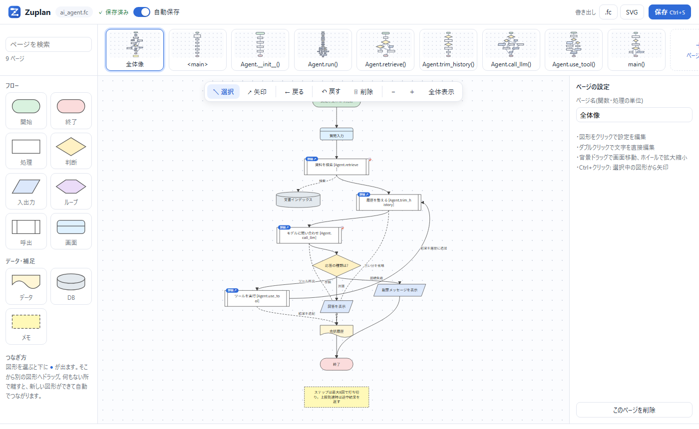

<p align="center">
  
</p>

<h1 align="center">Zuplan</h1>

<p align="center">
  <b>図で描く仕様書。AIがそのまま実装する。</b><br>
  Draw your program's spec as a flowchart — and let AI implement it.
</p>

<p align="center">
  <a href="LICENSE"></a>
  
  
  
</p>



言葉だけでは伝えにくい複雑な処理の流れを、**フローチャートで描いてAIに渡す**ためのツールです。
描いた図は、AIが読みやすい軽量なテキスト形式(`.fc`)で保存されます。AIはURLやMCPから最新の図を読んで、図どおりに実装します。

> **English summary** — Zuplan is a lightweight, self-hosted flowchart editor whose diagrams are stored in a compact, LLM-friendly text format (`.fc`). AI agents read (and write) diagrams through a simple HTTP API or the built-in MCP server, so you can hand over complex control flow as a picture instead of prose. Pure Python standard library, no dependencies. The UI and docs are currently in Japanese.

## 特長
- **ブラウザで描ける図エディタ** — draw.io のような操作感。図形・矢印・ページにメモを残せます。自動保存つき。
- **AI向けの軽量な形式 `.fc`** — 1行1要素。座標は別に保存するので、AIが読む量(トークン)を最小限にできます。
- **AIとの連携** — 図のURLを渡すだけで、AIが読み取り用APIから最新の図を読めます。**MCPサーバ**も内蔵しているので、Claude Code などから図を直接読み書きできます。
- **保存時の検査** — 開始が1つか、分岐にラベルがあるか、行き止まりがないか などを自動で確認します。
- **変更履歴** — 保存のたびに「何が変わったか」を記録します。AIはユーザーが直した点だけを確認できます。
- **大きなプロジェクトでも軽い** — ページ単位で保存します。1万ページ(django を丸ごと図にした規模)でも、開くのに約0.4秒、1ページの保存は1KB未満です。
- **依存ライブラリなし** — Python の標準ライブラリだけで動きます。

## すぐ試す

[uv](https://docs.astral.sh/uv/) を使います。

**Windows**: `start.bat` をダブルクリックすると、サーバが起動してブラウザが開きます(止めるときは Ctrl+C)。

**コマンド**:
```bash
git clone https://github.com/arisu-myo/zuplan.git
cd zuplan
uv run zuplan --serve                        # 起動して新しい図を開く
uv run zuplan --serve examples/ai_agent.fc   # 見本の図を取り込んで開く
```

図は `data/flowchart.db`(SQLite)に保存されます。

## AIに渡す

### 1. 図のURLを渡す
エディタのURL(`http://127.0.0.1:8000/s/<ID>`)をそのままAIに渡せば、AIは次のAPIから図を読めます。

| API | 内容 |
|---|---|
| `GET /api/s/<ID>/fc` | 図全体を `.fc` テキスト(先頭に読み方ルール)で返す。`?page=名前` で1ページだけ |
| `GET /api/s/<ID>` | ページの一覧(名前・図形数・版番号) |
| `GET /api/s/<ID>/log` | 変更履歴 |
| `POST /api/new?name=名前` | 本文の `.fc` から新しい図を作る(座標は自動配置) |

API の一覧と、AI向けの詳しい説明はトップページ(`http://127.0.0.1:8000/`)にあります。AIにトップページのURLを渡して「このツールで新しいプロジェクトを作って」と頼むこともできます。

### 2. MCP で使う
```bash
claude mcp add --transport http zuplan http://127.0.0.1:8000/mcp
```

| 道具 | 内容 |
|---|---|
| `list_pages` | ページ一覧と図のURL |
| `read_fc` | 図を `.fc` で読む(1ページだけにも絞れる) |
| `validate` | 図を検査する |
| `read_log` | 変更履歴を読む |
| `create_diagram` | `.fc` から新しい図を作る |
| `write_pages` | ページを上書き・追加・削除する |

## `.fc` 形式
```
fc1
## login            ← ページ(関数・処理の単位)
a start 開始        ← id 種別 テキスト
b io ID入力
c if 認証OK?
; 3回失敗でロック    ← 直前の行へのメモ
a>b
b>c
c>d Yes            ← 元>先 ラベル
```
種別: `start end proc if io loop call screen data db note`。`data` / `db` / `note` につなぐ矢印は、実行順ではなく読み書きなどの関係を表します。`call` のテキストにページ名を含めると、全体像のページから詳細のページへたどれます。

## エディタの使い方
- 左のパレットから図形をドラッグ(またはクリック)して追加します。図形を選ぶと下に出る ● から線を伸ばしてつなぎます。
- 右クリックで、図形・矢印・ページのメニューが出ます。メモは右のパネルに書きます(AIにも渡ります)。
- ページは上のカードで切り替えます。左上の検索欄でページ名を絞り込めます。
- 「呼出」図形の「詳細 ↗」から、そのページへ移動できます(「← 戻る」で戻る)。
- 書き出し: `.fc`(読み方ルール付き)/ SVG。

## 手元のパソコンで使うツールです
Zuplan は、自分のパソコンの中で使う便利ツールです。サーバに置いてインターネットに公開する用途は想定しておらず、ほかのパソコンからのアクセスには応答しません([SECURITY.md](SECURITY.md))。

## コマンド一覧
```bash
uv run zuplan --serve [file.fc | file.py]   # エディタを起動(ファイルを渡すと取り込んで開く)
     --port 8000  --db data/flowchart.db
uv run zuplan my.py --fc                    # Python コード → .fc(out/my.fc)
uv run zuplan my.py --html                  # Python コード → Mermaid の HTML(out/my.html)
uv run zuplan old.fc --diff new.fc          # 2つの .fc の意味的な差分
```
Python コードの取り込みは、1文を1図形にする簡易的なものです。

## 構成
| ファイル | 役割 |
|---|---|
| `flowchart.py` | コマンドとサーバ(URLの振り分け)、Python コードの取り込み |
| `store.py` | 図の保存(SQLite。ページ単位) |
| `fcspec.py` | `.fc` の読み書き・検査・自動配置・差分 |
| `mcp_server.py` | MCP サーバ |
| `access.py` | アクセスの制限 |
| `editor_page.py` / `static/` | 図エディタ(HTML の枠組み / JS・CSS・ロゴ) |
| `landing_page.py` | トップページ(AI向けの説明・API一覧) |
| `examples/` | 見本(`ai_agent.py` と、それを図にした `ai_agent.fc`) |
| `start.bat` | Windows 用の起動ファイル |

## 今後の予定
- 文章から図の下書きを作る
- 図と実装コードのずれの照合

## ライセンス
[MIT](LICENSE)
